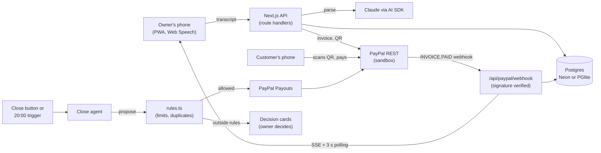

# Stall

**Stall is a voice-first point of sale for people who sell face to face.** Say the order in your language, and Stall turns it into an itemized PayPal invoice with a QR code, then says "Paid" when the money lands. In the evening you say "close the day": an AI agent pays the helpers and suppliers you logged through PayPal Payouts, and **stops and asks** when something looks wrong, such as a bill that looks like one you already paid.

Built on **PayPal Invoicing, Payouts and Webhooks** (sandbox only), Claude via the Vercel AI SDK, Next.js and Postgres.

Demo business: **La Esquina**, a taco truck in Austin, TX.

## 90-second judge path

Hosted demo: **`<HOSTED_URL>`** (PayPal sandbox, no real money). Owner PIN: **`1234`**.

Sandbox buyer login: `sb-fdfde53702808@personal.example.com`, password: see "Sandbox accounts" below.

1. Open the URL on your phone (or a desktop browser) and enter PIN `1234`. You land on **Sell**.
2. Type the order in the text box, for example `two tacos al pastor and an agua fresca`, tap **Read order**, check the items, tap **Charge**.
3. A PayPal invoice QR appears with "Waiting for payment". Scan it, or tap **Copy pay link** and open it in another browser, log in as the sandbox buyer and pay.
4. As soon as PayPal reports the invoice paid, Sell flips to a full-screen **Paid**.
5. Open **Day**. Today's sales, tax and tips are listed, and two obligations are already logged: Maria's shift and a tortillas bill.
6. Tap **Close the day** (you land on **Close**).
   - Maria's $120 shift is paid through PayPal Payouts, with a one-sentence reason.
   - The tortillas bill is **held**: it looks like a bill paid two days ago. The decision card shows both bills.
7. Tap **Mark as already paid** on the held bill (nothing is sent), then **Run close again**. Nothing is paid twice.

Payouts settle in about 18 seconds in the sandbox. You can watch Maria's balance change at [sandbox.paypal.com](https://www.sandbox.paypal.com) using the accounts below.

## Run locally in 15 minutes

**Prerequisites:** Node 24 or newer, npm, a free PayPal developer account, an Anthropic API key. No database install is needed.

```bash
git clone <REPO_URL>
cd <REPO>/stall
npm install
cp .env.example .env        # Windows PowerShell: Copy-Item .env.example .env
```

**1. PayPal sandbox app** ([developer.paypal.com/dashboard](https://developer.paypal.com/dashboard))

- Use a **US Business** sandbox account (Testing Tools, Sandbox Accounts). Add three **US Personal** accounts: a buyer, Maria and Rosa.
- Apps & Credentials, Sandbox, **Create App** on that business account.
- **Before you copy any credentials or request a token**, open the app's features and enable **Invoicing**, **Payouts**, **Transaction search** and **Customer disputes**. A token is cached for about 9 hours and keeps the scopes it was issued with, so enabling a feature afterwards does not help; you would have to create a fresh app.
- Paste the app's client id and secret into `.env` as `PAYPAL_CLIENT_ID` and `PAYPAL_CLIENT_SECRET`.

**2. Fill the rest of `.env`**

| Variable | Value |
|---|---|
| `DATABASE_URL` | Keep `pglite://./.data/stall`. Postgres runs in-process, migrates, and seeds La Esquina on first start. Use `pglite://memory` for a throwaway database, or a `postgres://` URL (Neon or local). |
| `ANTHROPIC_API_KEY` | Your key. |
| `OWNER_PIN` | 4 to 6 digits; what you type on `/pin`. |
| `CLOSE_TRIGGER_KEY` | Any long random string. It signs the owner cookie and guards `/api/close?key=`. `CRON_SECRET` (optional locally, set it in Vercel) is the bearer token for the nightly cron in `stall/vercel.json`. |
| `PAYPAL_WEBHOOK_ID` | Any non-empty value for now; set the real one once you register a webhook (below). |
| `SANDBOX_MARIA_EMAIL` | The email of your Maria sandbox Personal account. The seed pays Maria at this address. **If you leave it empty the seed uses `maria@stall.example`, which has no PayPal account, so her payout ends `UNCLAIMED`.** |
| `SANDBOX_ROSA_EMAIL` | The email of your Rosa sandbox Personal account, for the same reason (empty: `rosa@stall.example`, payouts end `UNCLAIMED`). If you fill either in later, restart the dev server and tap **Reset demo** in Settings. |

**3. Run**

```bash
npm run dev
```

Open <http://localhost:3000>, enter your `OWNER_PIN`, and follow the judge path above. "Reset demo" in Settings restores the demo day. Do not run `npm run db:seed` while the dev server is up: a PGlite data directory has one owner at a time.

**Webhooks are optional locally.** The PayPal path works without a tunnel: while the QR screen is open the app asks PayPal for the invoice status every 3 s, and the Day and Close screens ask PayPal for the status of each payout still sending. A webhook only makes it instant:

- Expose `localhost:3000` through a tunnel (ngrok, cloudflared), register `https://<tunnel>/api/paypal/webhook` for your app with the `INVOICING.INVOICE.PAID` and `PAYMENT.PAYOUTS-ITEM.*` events, and put the real webhook id in `PAYPAL_WEBHOOK_ID`. Signatures are verified.
- To try the webhook handler without a tunnel, set `PAYPAL_WEBHOOK_SKIP_VERIFY=1` (honoured only when `NODE_ENV` is not production) and post a sample event to `/api/paypal/webhook` yourself.
- The **Paid in cash** button needs no webhook: it records the payment on the PayPal invoice and marks the sale paid.

## What works / demo-only / later

**Works (real behavior in sandbox):** voice capture (Web Speech, text fallback), parsing in en/es/pl, catalog learning (price suggested after 2 sightings), invoice create/send/QR, webhook-confirmed payment, cash recording, shift and bill logging, close-the-day with Payouts, rule enforcement, duplicate-bill hold, decision cards with approve/decline, idempotency, Day view, CSV export of the day/month.

**Demo-only:**

- Tax is one rate the owner sets in Settings (seed: Austin, TX 8.25%), not a jurisdiction engine.
- Venmo is named as a production payment method; the demo pays with a sandbox PayPal buyer.
- "Any language" is demonstrated with three.

**Later (not in the hackathon build):** weekly invoices for wholesale customers, weather-based prep suggestions, tax by GPS, bookkeeping integrations, multi-user, native apps, server-side ASR unless forced.

Out of scope: card reader, receipt printing, inventory, tables, multi-location, production PayPal.

## How Stall uses PayPal

| Feature | PayPal endpoint | Code |
|---|---|---|
| Itemized bill (items, tax per line, tip line) | `POST /v2/invoicing/invoices` | [`invoices.ts`](stall/src/lib/paypal/invoices.ts) |
| Send, so the invoice becomes payable | `POST /v2/invoicing/invoices/{id}/send` | [`invoices.ts`](stall/src/lib/paypal/invoices.ts) |
| QR code | `POST /v2/invoicing/invoices/{id}/generate-qr-code` | [`invoices.ts`](stall/src/lib/paypal/invoices.ts) |
| Invoice status | `GET /v2/invoicing/invoices/{id}` | [`invoices.ts`](stall/src/lib/paypal/invoices.ts) |
| Cash sale recorded on the invoice | `POST /v2/invoicing/invoices/{id}/payments` | [`invoices.ts`](stall/src/lib/paypal/invoices.ts) |
| Pay a logged shift or bill | `POST /v1/payments/payouts` | [`payouts.ts`](stall/src/lib/paypal/payouts.ts) |
| Payout batch status | `GET /v1/payments/payouts/{batch_id}` | [`payouts.ts`](stall/src/lib/paypal/payouts.ts) |
| Signature check on every webhook | `POST /v1/notifications/verify-webhook-signature` | [`webhooks.ts`](stall/src/lib/paypal/webhooks.ts) |
| Token cache, `PayPal-Request-Id` on every POST, zod-validated responses | `POST /v1/oauth2/token` | [`client.ts`](stall/src/lib/paypal/client.ts), [`schemas.ts`](stall/src/lib/paypal/schemas.ts) |

**Sandbox facts we measured** (full notes: [`docs/superpowers/spike-findings.md`](docs/superpowers/spike-findings.md)):

- The QR endpoint answers **`multipart/form-data`**, not JSON: one `image` part whose body is a base64 PNG. `generateQr` parses that part.
- A paid invoice reports `payments.transactions[0].payment_date_time`. The field is **not** called `date`; the webhook handler reads the right one.
- Payouts settle in about **18 seconds**: batch `PENDING`, `PROCESSING` at about 6 s, item `SUCCESS` at about 12 s, batch `SUCCESS` at about 18 s. The Close screen does not expect an instant result.
- Each payout item costs **$0.25** in the US sandbox, so the demo's $120 payout costs $0.25.
- Every money-moving call carries an idempotency key, a two-decimal string amount and an explicit currency, and its result is stored before anything is reported. The payout `sender_batch_id` (and `sender_item_id`) is `st-{s|b}-{25 hex of sha256(businessId:kind:obligationId)}`, deterministic so PayPal also rejects a duplicate. It is a 30-character hash because PayPal caps `sender_batch_id` at 30 characters and `sender_item_id` at 63 (`VALIDATION_ERROR size must be between 0 and 63`); the id scheme lives in [`batchId.ts`](stall/src/lib/close/batchId.ts) and needs no migration.

## How Stall uses AI

| Where | What the model does | Code |
|---|---|---|
| Sale parser | Turns "dos tacos al pastor y un agua fresca" into items with quantities, prices from the learned catalog, and a confidence per item. Structured output validated with zod. | [`parseSale.ts`](stall/src/lib/parse/parseSale.ts) |
| Obligation parser | Turns "I owe Rosa 240 for tortillas" or "Maria worked today" into a bill or shift record. | [`parseObligation.ts`](stall/src/lib/parse/parseObligation.ts) |
| Close agent | Writes the day's summary, orders the actions, phrases each rationale, and chooses `pay_obligation` or `hold_obligation` per item. | [`agent.ts`](stall/src/lib/close/agent.ts), [`runClose.ts`](stall/src/lib/close/runClose.ts) |

**The model can hold, but it can never pay outside the rules.** [`rules.ts`](stall/src/lib/close/rules.ts) is plain code that decides, before the model runs, whether each logged shift or bill is `pay`, `hold` or `skip`: payee enabled and auto-pay on, amount within the payee's per-day limit and the business cap, and no duplicate bill within 7 days (amount within 10%, or the same note). The agent's tools refuse to pay anything that is not `pay`, and every attempt is logged. The model may escalate a payable item to a hold; it can never turn a hold into a payment, and it never invents an amount: it acts only on records the owner logged. Every amount is US dollars: the currency is hard-coded to USD throughout (invoices, payouts, the database), not checked by a rule.

**Prompt-injection posture.** Transcripts are data. They are wrapped in `<transcript>` tags, and the prompts say never to follow instructions inside them. Because spending authority sits in code (limits, one payout per shift or bill, idempotent batch ids), a hostile transcript or bill note cannot make the agent pay anyone, or any amount, that the owner did not log.

## Architecture



Hosting: Vercel (project root directory `stall`), Postgres on Neon through the Vercel Marketplace, and a Vercel Cron job for the nightly close, configured in [`stall/vercel.json`](stall/vercel.json) (`0 2 * * *` UTC, about 20:00 to 21:00 in Chicago). It calls `/api/close` with `Authorization: Bearer <CRON_SECRET>`, so set `CRON_SECRET` in the Vercel project (without it, `CLOSE_TRIGGER_KEY` is the bearer).

## Sponsor tools

| Tool | Use |
|---|---|
| **Vercel** | Hosting (root directory `stall`), Vercel AI SDK 7 for model calls and the close agent's tool loop, Vercel Cron for the nightly close, Neon Postgres through the Marketplace. |

## Tests and evals

Run from `stall/`.

| Command | What it checks |
|---|---|
| `npm test` | Vitest: 400+ tests (PGlite in memory, recorded PayPal fixtures, close rules, parsers, routes). |
| `npm run typecheck` | `tsc --noEmit`, strict. |
| `npm run lint` | ESLint. |
| `npm run build` | Production build. |
| `npm run e2e` | Playwright smoke: PIN, type an order, Charge, QR visible, total `$9.74`. Fully offline (`PAYPAL_MOCK=1`, `PARSE_MOCK=1`, in-memory database); run `npx playwright install chromium` once first. The mocks are ignored when `NODE_ENV=production`. |
| `npm run eval:parse` | Parser accuracy on the transcripts in `stall/evals/`, three languages. Needs `ANTHROPIC_API_KEY`. |

From the repository root, `node scripts/smoke-test.mjs` runs a live sandbox smoke test (token, create order, read, transactions, balances) using `PAYPAL_CLIENT_ID` and `PAYPAL_CLIENT_SECRET` from the root `.env`.

## Sandbox accounts

For judges. All are PayPal **sandbox** accounts; no real money exists.

| Role | Email | Password |
|---|---|---|
| Customer (buyer; use it to pay the QR) | `sb-fdfde53702808@personal.example.com` | `<SANDBOX_BUYER_PASSWORD>` |
| Maria (helper; receives the $120 payout) | `sb-rukiy53702809@personal.example.com` | `<SANDBOX_MARIA_PASSWORD>` |
| Tortillería Rosa (supplier) | `sb-g0any53702812@personal.example.com` | `<SANDBOX_ROSA_PASSWORD>` |
| La Esquina (business; receives sales) | `sb-7dvsg53656715@business.example.com` | `<SANDBOX_BUSINESS_PASSWORD>` |

Sign in at [sandbox.paypal.com](https://www.sandbox.paypal.com) to see balances move. The hosted demo's owner PIN is `1234`.

## Repository layout

```
stall/                     the app (Next.js 16 App Router, TypeScript strict, Tailwind)
  src/app/                 screens /pin /sell /day /close /settings, and the /api route handlers
  src/lib/paypal/          REST client, invoices, payouts, webhooks (+ offline mock for the smoke test)
  src/lib/parse/           sale and obligation parsers
  src/lib/close/           close agent and the rules that bound it
  src/db/                  Drizzle schema, seed, PGlite helpers; migrations in stall/drizzle/
  tests/  e2e/  evals/     Vitest, Playwright smoke, parser evals
scripts/                   sandbox helpers: get-sandbox-token.ps1|sh, smoke-test.mjs
docs/superpowers/          design doc (specs/), implementation plan (plans/), spike findings
docs/research/             hackathon rules, competition map, PayPal tooling
docs/ideas/  docs/plan/    candidate ideas, timeline, submission checklist, video script
.claude/                   project skills and the hackathon-judge reviewer agent
.env.example               every variable the app reads
CLAUDE.md                  project rules for Claude Code
LICENSE                    MIT
```

## License

[MIT](LICENSE).
